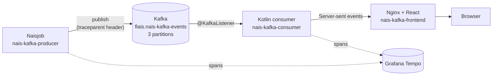

# NAIS Kafka

A small demo of Kafka and OpenTelemetry on the Novari NAIS platform. A
**Naisjob** publishes sensor readings to Kafka every two minutes, a
**Kotlin / Spring Boot** consumer reads them, and a **React** frontend shows
them live. One trace follows each event from the job, through Kafka, into the
consumer.



## Run locally

Requirements: Docker with Compose. The container builds supply Node and the JDK.

```sh
docker compose up --build
```

- **<http://localhost:3000>**: the frontend.
- **<http://localhost:3001>**: Grafana with Tempo (Explore → Tempo). Every trace
  link in the UI opens here.

Compose starts Kafka, creates the topic, starts the consumer and frontend, and
runs the producer once. Publish another batch with:

```sh
docker compose run --rm producer
```

Locally the containers run the OpenTelemetry Java agent themselves (the `local`
Dockerfile target). On NAIS the platform injects it.

## Develop

Requirements: [mise](https://mise.jdx.dev) (installs Java and Node from
`mise.toml`) and Docker.

```sh
mise install

# Kafka and Grafana only.
docker compose up -d kafka kafka-init lgtm

# Terminal 1: consumer on localhost:8080
./gradlew :consumer:bootRun

# Terminal 2: frontend on localhost:5173, proxying /api to the consumer
cd frontend && npm ci && npm run dev

# Publish a batch
./gradlew :producer:bootRun
```

Without the agent, local runs record no trace ids, so the UI shows no trace
links.

## How it works

1. **Producer (Naisjob).** Every two minutes the job starts, publishes 10 events
   and exits. Each event is a reading from one of six simulated devices. The
   record key is the device id, so each device stays on one partition and in
   order. The run fails unless the broker acknowledges every record.

2. **Tracing.** Each run opens a `producer run` span. Every run is a new JVM,
   so first-time costs land in every run. The job pays them before creating any
   event, each in its own span, so they stay out of the events' latency:
   `kafka connect` opens the TLS connection and fetches topic metadata (seconds
   against Aiven), and `json warmup` sets up Jackson (about a second in a pod).
   The agent's Kafka instrumentation then makes each send a child span and
   writes the W3C `traceparent` header into the record. The agent in the
   consumer continues that trace when `@KafkaListener` processes the record, so
   job → Kafka → consumer is one trace:

   ```text
   producer run                                  nais-kafka-producer
   ├── kafka connect
   ├── json warmup
   └── flais.nais-kafka-events publish           one per event
       └── flais.nais-kafka-events process       nais-kafka-consumer
   ```

3. **Consumer.** The listener keeps the latest 100 events in memory, with
   partition, offset, consuming pod and trace id, and pushes new events to
   browsers over server-sent events. State is per replica, so the app runs one
   replica. On partition assignment it replays the newest records of each
   partition, so a restart shows events immediately instead of after the next
   job run.

4. **Frontend.** Nginx serves the React app and proxies `/api` to the consumer,
   with buffering off for the event stream. Browsers deduplicate by event id and
   reconcile with `/api/events` every ten seconds. On NAIS the app also runs
   [Grafana Faro](https://grafana.com/oss/faro/) (see
   [Frontend telemetry](#frontend-telemetry)).

| Endpoint (consumer) | Purpose |
| --- | --- |
| `GET /api/events` | Latest 100 consumed events |
| `GET /api/stream` | Server-sent events: `connected`, `event`, `heartbeat` |
| `GET /api/info` | Replica, topic, consumer group, events per partition, Grafana settings |

## Verify

```sh
./gradlew build                 # Embedded Kafka integration tests; no Docker needed
(cd frontend && npm test && npm run build)
mise run lint:md                # Markdown; fix with: rumdl fmt
```

To check trace propagation with the real agent, download the
[OpenTelemetry Java agent](https://github.com/open-telemetry/opentelemetry-java-instrumentation/releases)
and run:

```sh
./gradlew :consumer:test --rerun -PotelAgent=build/otel-agent.jar
./gradlew :producer:test --rerun -PotelAgent=build/otel-agent.jar
```

The spans are printed to the terminal. The consumer test also asserts that the
consumer's trace id is the producer's. The producer test shows the run's span
structure, from `kafka connect` and `json warmup` to `producer run`.

## Deploy to Novari NAIS

Team `flais`, environment `test`, Kafka pool `novari-test`.

| Manifest | Resource |
| --- | --- |
| `.nais/topic.yaml` | Topic `nais-kafka-events` (`flais.nais-kafka-events` for clients) with write access for the producer and read access for the consumer |
| `producer/.nais/naisjob.yaml` | Naisjob, schedule `*/2 * * * *`, `concurrencyPolicy: Forbid` |
| `consumer/.nais/app.yaml` | Application without ingress; only the frontend may call it |
| `frontend/.nais/app.yaml` | Application with ingress <https://nais-kafka.test.novari.cloud.nais.io> and generated Faro config |

Kafka credentials come from the variables NAIS injects (`KAFKA_BROKERS`,
`KAFKA_KEYSTORE_PATH`, `KAFKA_TRUSTSTORE_PATH`, `KAFKA_CREDSTORE_PASSWORD`),
read by the `nais` Spring profile. Both Kafka workloads enable
`observability.autoInstrumentation` for Java. Traces are in
[Grafana](https://grafana.novari.cloud.nais.io/explore), for example with
`{resource.service.name="nais-kafka-consumer"}`.

The UI's trace links need the UID of the Tempo datasource for the environment.
Each environment has its own; find them under `tracesDataSource.byEnvironment`
in <https://grafana.novari.cloud.nais.io/api/plugins/nais-apm-app/settings>. The
`nais` profile defaults to the one for `test`. For another environment, set
`GRAFANA_TEMPO_DATASOURCE` in the consumer's manifest.

### Frontend telemetry

The browser app reports to Nais APM with
[Grafana Faro](https://docs.novari.cloud.nais.io/observability/frontend/): Web
Vitals, JavaScript errors (including rendering errors, through an error
boundary) and browser traces.

- **Config.** `spec.frontend.generatedConfig` makes Nais write `/js/nais.js`
  with the collector URL and the app's name, namespace and version. The app
  loads it at runtime. Locally the file does not exist, so Faro stays off and
  its code is never downloaded: it is a separate bundle chunk.
- **Traces.** Faro adds a `traceparent` header to `/api` requests, so a trace
  runs from the browser through nginx (its access log gets the `trace_id`) to
  the consumer's HTTP span. The live event stream is not traced, because
  `EventSource` cannot set headers. Each event's own trace, from the job through
  Kafka, is separate and opens from the event's trace link.

Look under the Frontend tab of `nais-kafka-frontend` in
[Nais APM](https://grafana.novari.cloud.nais.io/a/nais-apm-app/services).

### Logs

With the `nais` profile, the producer and consumer log one JSON object per line
(Spring Boot's `logstash` structured format), so Loki keeps multi-line messages
such as stack traces and Kafka's config dump as one record. Locally they log
plain text.

Every line carries `level`, `logger_name` and `message`. The agent adds
`trace_id` and `span_id`, which link logs and traces in Nais APM. The apps add:

| Service | Fields |
| --- | --- |
| `nais-kafka-producer` | `run_id` on every line of a run; `kafka_connect_ms`, `json_warmup_ms`, `events`, `records_per_partition` |
| `nais-kafka-consumer` | One line per event: `event_id`, `run_id`, `device_id`, `partition`, `offset`, `latency_ms`, `new` (false when replayed). `open_streams` when browsers connect or disconnect |
| `nais-kafka-frontend` | Nginx access log, one line per request: `method`, `path`, `query`, `status`, `bytes`, `request_time_s`, `upstream_time_s`, `trace_id` (from a `traceparent` header). `level` is `ERROR` for 5xx and `WARN` for 4xx. No client IPs or user agents |

Example queries in [Grafana](https://grafana.novari.cloud.nais.io/explore) with
Loki:

```logql
{service_name="nais-kafka-producer", service_namespace="flais"} | json | kafka_connect_ms > 3000
{service_name="nais-kafka-consumer", service_namespace="flais"} | json | device_id="device-5"
{service_name="nais-kafka-consumer", service_namespace="flais"} | json | run_id="<run id from the UI>"
{service_name="nais-kafka-frontend", service_namespace="flais"} | json | path=~"/api/.*" | status >= 500
```

Nginx writes an access log line when a request ends. The event stream
(`/api/stream`) stays open, so its line appears when the browser disconnects,
with `request_time_s` showing how long it was connected. Nginx's error log is
plain text.

### GitHub Actions

Each deployable has its own workflow that builds the image with
`nais/docker-build-push`, then deploys with `nais apply`. Workflows run on
pushes to `main` that touch their paths, and can be started manually.

- `deploy-producer.yaml` and `deploy-consumer.yaml` apply the topic, then their
  workload. Either can be deployed first.
- `deploy-frontend.yaml` deploys the frontend.
- `ci.yaml` builds and tests on every push.

Before the first run, authorize this repository for team `flais` in Nais
Console.

### Manual deployment

```sh
nais apply .nais/topic.yaml --environment test --team flais --wait
nais apply producer/.nais/naisjob.yaml --environment test --team flais --set spec.image=YOUR_PRODUCER_IMAGE --wait
nais apply consumer/.nais/app.yaml --environment test --team flais --set spec.image=YOUR_CONSUMER_IMAGE --wait
nais apply frontend/.nais/app.yaml --environment test --team flais --set spec.image=YOUR_FRONTEND_IMAGE --wait
```

## Demo ideas

- Watch a batch arrive every two minutes. Compare partitions and offsets for the
  same device.
- Open a trace link: one trace from the job's `producer run` to the consumer's
  `process` spans. Compare `kafka connect` and `json warmup`, the cost of
  starting fresh in a cron job, with the time the events spend in Kafka, shown
  as milliseconds on each event in the UI.
- In the browser's network tools, a request to `/api/events` carries a
  `traceparent` header. Its trace in Tempo runs from the browser through the
  consumer, and nginx's log line for the request has the same `trace_id`.
- Restart the consumer pod. The feed refills from Kafka right away.
- Look at consumer lag and Kafka client metrics on `/actuator/prometheus`.

## Repository

| Path | Purpose |
| --- | --- |
| `events/` | Shared event type and topic name |
| `producer/` | Naisjob: publishes one traced batch and exits |
| `consumer/` | Kotlin Spring Boot consumer, API and server-sent events |
| `frontend/` | React, TypeScript, Tailwind CSS and Nginx reverse proxy |
| `.nais/topic.yaml` | Kafka topic and access |
| `compose.yaml` | Local Kafka, Grafana LGTM and all three deployables |
| `mise.toml` | Java and Node versions |
| `.cplt.toml` | Sandbox permissions for AI agents running under cplt |
